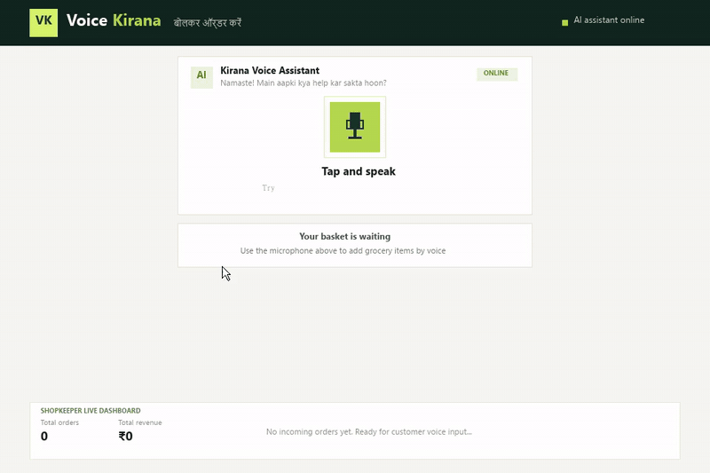

# VoiceKirana — बोलकर किराना ऑर्डर करें 🌾

> AI-powered Hinglish voice-ordering system for local Indian kirana stores with real-time shopkeeper dashboard.



## 🌟 Demo Walkthrough
1. **Tap & Speak**: Speak naturally in Hindi / Hinglish (e.g. *“2 किलो चावल, एक किलो तेल, और दो पैकेट मैगी देना”*).
2. **AI Speech-to-Text**: Transcribed in real-time via **Gnani Prisma v2.5** (`hi-IN`).
3. **Structured Order Parsing**: Accurately extracts grocery items, Hindi Devanagari numerals, and measurement units (`kg`, `litre`, `packet`).
4. **Order Confirmation & TTS**: Customer reviews the catalogue-verified draft and confirms; **Gnani Timbre v2.5 (Nalini)** provides spoken voice confirmation.
5. **Shopkeeper Live Dashboard**: Instantly tracks incoming orders, revenues, and fulfillment status.

## Prerequisites
- Node.js 20+
- MongoDB local or Atlas connection string
- Gnani API key from https://app.gnani.ai

## 1. Configure backend
```bash
cd server
cp .env.example .env
# Add GNANI_API_KEY and MONGODB_URI
npm install
npm run dev
```

## 2. Run frontend (new terminal)
```bash
cd client
npm install
npm run dev
```
Open the Vite URL. Allow microphone access.

## What works in this starter
- Browser microphone recording (short clips, up to 30 seconds), converted to mono 16 kHz WAV on the backend
- Backend upload to Gnani Prisma v2.5 REST endpoint
- Simple catalogue-backed Hinglish order extraction
- Order confirmation before saving
- Timbre v2.5 speech generation
- MongoDB order persistence (if MONGODB_URI is configured)
- Dashboard refreshes by polling the orders endpoint

## Important limitations
- The order parser is deliberately deterministic and is not an LLM. It supports the sample catalogue and common Hinglish number/product phrases; extend it or connect a structured-output LLM before production.
- Phone-call integration is not implemented yet. Add a telephony provider after validating its Indian-number availability, webhook security, media streaming format, and ability to return audio to an active call.
- Prisma REST accepts supported short audio clips up to 30 seconds. Browser WebM audio is converted to mono 16 kHz WAV using ffmpeg before upload. For low-latency live conversations, implement Gnani's WebSocket streaming protocol.
- Never expose GNANI_API_KEY in the browser.
- Add authentication, rate limits, consent, PII retention controls, and robust validation before real customers use it.

## API
- `POST /api/voice/transcribe` multipart field `audio`
- `POST /api/voice/speak` JSON `{ "text": "..." }`
- `POST /api/orders/parse` JSON `{ "transcript": "..." }`
- `POST /api/orders` JSON `{ "customerName": "...", "phone": "...", "channel": "web", "items": [...] }`
- `GET /api/orders`
- `PATCH /api/orders/:id/status` JSON `{ "status": "preparing" }`
- `GET /api/products`
